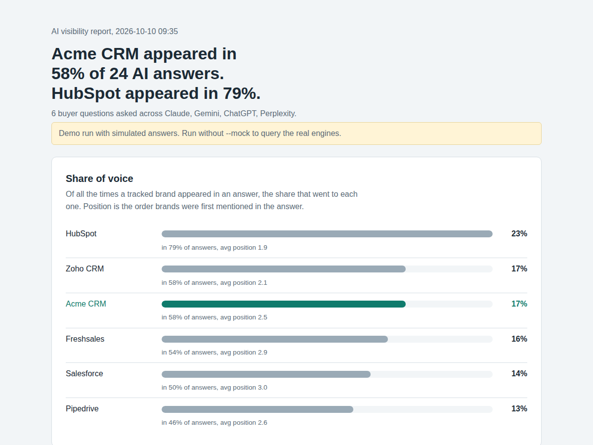

# AEO Visibility Tracker

Measures how often ChatGPT, Claude, Perplexity and Gemini mention your brand when people ask them buying questions, and how you compare with competitors.

More buyers now ask an AI assistant "what's the best CRM for a small agency?" instead of searching Google. If your brand isn't in that answer, you never get the click. Classic SEO tools don't show this. This tracker asks the engines the questions your buyers ask, records every answer, and turns them into share of voice, position and gap reports you can track over time.



## What it measures

- **Mention rate:** the share of answers that name your brand, per engine and overall.
- **Share of voice:** of all tracked-brand mentions, the share that went to you versus each competitor.
- **Position:** where you're first mentioned relative to competitors (1 means named first).
- **Question gaps:** which questions you're missing from, and which competitors were named instead. This is your content to-do list.
- **Cited sources:** which websites the search-based engines (Perplexity) used as sources. Getting featured on those sites is the fastest way into the answers.
- **History:** every run is appended to `results/history.csv`, so you can track progress after publishing new content.

## Report

Each run produces a self-contained `report.html`:

- A headline comparing you with the most-mentioned competitor
- A share of voice leaderboard
- A mention-rate grid by engine
- A question-by-question coverage table showing who appeared when you didn't
- Every answer in full, with your brand and competitors highlighted

Also written: `answers.csv`, `answers.jsonl` (full raw answers) and `summary.csv`.

## Quick start

Try it without API keys using simulated answers:

```bash
pip install -r requirements.txt
python aeo_tracker.py --config config.example.yaml --mock
```

Open the `report.html` path it prints.

## Real run

1. Copy the config and edit it with your brand, competitors and buyer questions:

   ```bash
   cp config.example.yaml config.yaml
   ```

2. Copy `.env.example` to `.env` and add API keys for the engines you want. Remove any engine you don't have a key for from `config.yaml`.

   | Engine | Key | Get one at |
   |---|---|---|
   | ChatGPT | `OPENAI_API_KEY` | platform.openai.com |
   | Claude | `ANTHROPIC_API_KEY` | console.anthropic.com |
   | Perplexity | `PERPLEXITY_API_KEY` | perplexity.ai (API settings) |
   | Gemini | `GEMINI_API_KEY` | aistudio.google.com |

3. Run it:

   ```bash
   python aeo_tracker.py --config config.yaml
   ```

A run of 10 questions across 4 engines is 40 API calls. With small models that usually costs well under a dollar.

## Writing good prompts

The prompts matter more than anything else. Write them the way buyers actually type:

- Category questions: "best CRM for a small marketing agency"
- Comparison questions: "HubSpot alternatives that are cheaper"
- Problem questions: "CRM that works with WhatsApp"
- Local or niche questions: "best dental implant clinic in Austin"

Avoid putting your own brand in the prompt. You want to know if the engine brings you up on its own.

## Options

| Option | Default | Description |
|---|---|---|
| `--config` | `config.yaml` | Config file |
| `--out` | `results` | Output folder |
| `--mock` | off | Simulated answers, no API keys |
| `--workers` | 4 | Parallel requests |

In `config.yaml`, set `runs_per_prompt` to 2 or 3 for steadier numbers, since AI answers vary from run to run.

## Limitations

- API answers are close to, but not identical to, what people see in the consumer apps. The apps add personalization, memory and (for ChatGPT, Claude and Gemini) live web search depending on settings. Perplexity's API uses web search; the others answer from model knowledge unless you add search.
- Mentions are detected by name matching. Add every common spelling to `aliases`. Very generic brand names may produce false matches.
- Position measures order of mention, not whether the mention was positive. Read the answers for context.

## Roadmap

- Sentiment of each mention (recommended, neutral, warned against)
- Web search tool enabled for OpenAI, Claude and Gemini
- Scheduled runs with a trend chart in the report

## License

MIT
